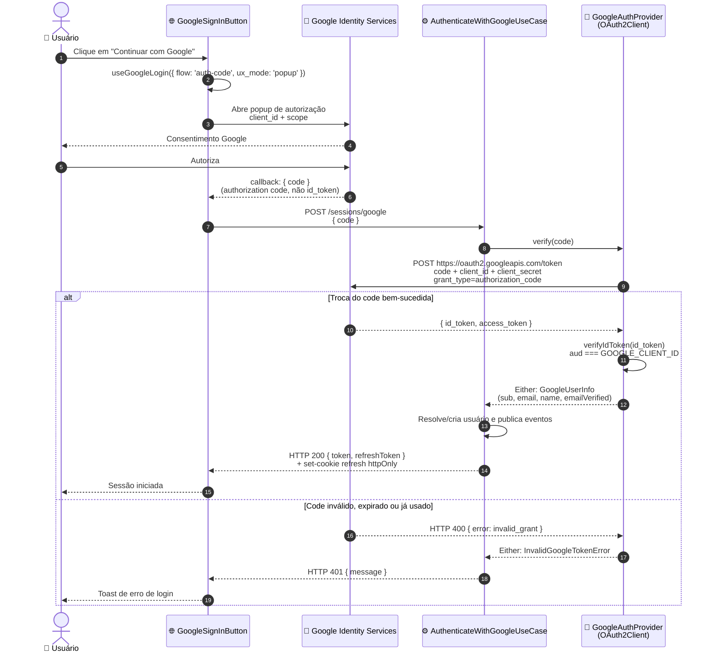

# Botão Google customizado (auth-code): Design

- **Norte visual:** `mockups/google-custom-signin-button-visual.md`
- **Diagrama fonte:** `diagrams/google-custom-signin-button-design_01_sequence_fluxo_auth_code_goog.mmd`

## Visão Geral

O botão de login com Google é o iframe oficial do Google: fonte, cores e ícone G fora do design system "Noite neon". Esta feature troca o botão por um botão próprio — `Button variant="outline"`, `font-display`, chanfro do tema, logo G oficial — e sustenta a troca mudando como o backend recebe a prova do Google: em vez de o browser mandar o ID token (JWT) e o backend só verificá-lo, o browser manda um **authorization code** e o backend o troca por tokens usando o client secret.

Success, observado de fora: login, cadastro e confirmação de senha mantêm as regras de conta e os erros de hoje (AC-08, AC-09); o botão deixa de destoar do resto do app nos dois temas (AC-02).

## Escopo

**Dentro:** botão customizado nas 3 telas (login, cadastro, perfil › senha) via componente compartilhado; fluxo auth-code com popup; troca e verificação no backend; rótulo único "Continuar com Google".

**Fora de escopo:** novos provedores (excluídos por `google-social-login`); UX de account linking e merge de contas (excluídos por `mixed-login-external-accounts`); redesign do shell das telas de auth (excluídos por `design-system-migration`); One Tap; refresh token do Google; logout do lado do Google.

**Lentes fechadas:** desempenho (sem volume citado — feature de UI); consistência de dados (nenhuma tabela nova — ver Dados).

## Características Arquiteturais

**Priorizadas (top 3):**

| Característica | Preocupação de domínio | Critério mensurável | Escopo |
|---|---|---|---|
| Segurança | Um token emitido para outro app não pode autenticar aqui | Toda sessão Google nasce de um code verificado com `aud` = `GOOGLE_CLIENT_ID` e `client_secret` no servidor; nenhum segredo no bundle | troca e verificação |
| Disponibilidade | Login é a porta de entrada; popup bloqueado é falha comum de navegador | Falha de popup ou do Google encerra o `isPending` (AC-04, AC-05) e a tela de login por e-mail permanece disponível | botão + tratamento de erro |
| Consistência visual | O botão precisa parecer parte do app | Botão usa `Button` do design system (fonte, chanfro, tokens de cor) e renderiza corretamente nos temas dark, sunset e light | componente |

## Arquitetura e Fluxo

O botão deixa de renderizar o iframe do Google e passa a acionar `useGoogleLogin({ flow: "auth-code", ux_mode: "popup" })`, que abre o popup de consentimento do Google e devolve `{ code }` no callback — nenhum token chega ao browser. O frontend envia `{ code }` para `POST /sessions/google`. O `GoogleAuthProvider` troca o code por tokens com o `client_secret` e verifica o `id_token` com `audience = GOOGLE_CLIENT_ID`; o `AuthenticateWithGoogleUseCase` recebe o mesmo `GoogleUserInfo` de hoje e percorre a resolução de usuário **sem alteração** — por `googleId`, depois por e-mail (409 `external_account_link_required`), depois criando a conta.

Rollout: troca direta, sem flag — o componente compartilhado concentra a mudança e as 3 telas migram juntas. O client secret precisa existir no ambiente antes do deploy (ver Riscos).

## Componentes

- **`GoogleSignInButton` (frontend, `features/auth/components/google-sign-in-button.tsx`)** — guarda a interface pública e o disparo do login. O prop `onSuccess` passa a receber o **authorization code** (`(code: string) => void`) em vez do `idToken`; `onError`, `disabled` e `isPending` seguem iguais, e as 3 telas mudam só o nome do parâmetro recebido. **Oculta:** o popup, o tratamento de `onNonOAuthError` e o ciclo de loading, que hoje são detalhe de implementação do `GoogleLogin`.
- **`useLoginWithGoogle` e `useCreatePasswordReauthGrant` (frontend, `features/auth/api/index.ts`)** — as duas mutações trocam o corpo `{ idToken }` por `{ code }` em `POST /sessions/google` e `POST /users/me/password/reauth`; `setSession`, o tratamento de `ApiError` e os mapeamentos de status por tela ficam como estão.
- **`CreatePasswordReauthGrantUseCase` (backend, `user/application/use-case/`)** — a entrada passa a `{ provider, code }`; as regras do grant de reautenticação e de conta permanecem as de `mixed-login-external-accounts`.
- **`GoogleAuthProvider` (backend, `session/application/provider/google-auth-provider.ts`)** — contrato da fronteira com o Google. **Oculta:** `OAuth2Client`, o `client_secret`, a URL de token e a forma de verificar o `id_token`. O caso de uso conhece `GoogleUserInfo`, não a lib.
- **`GoogleAuthProviderImpl` (backend, `session/infra/provider/`)** — troca o code, verifica o `id_token`, devolve `Either<InvalidGoogleTokenError, GoogleUserInfo>`. **Oculta:** `google-auth-library` e a forma da falha.
- **`AuthenticateWithGoogleUseCase` (backend)** — **inalterado.** Regra de resolução de usuário, eventos e emissão de JWT continuam os de `google-social-login`.
- **`GoogleGIcon` (frontend, `components/ui/`)** — SVG do logo G oficial. **Oculta:** os quatro caminhos de cor do logo, para que ele não se espalhe em JSX.

## Fronteiras e Contratos

**Contrato:**

| Operação | Entrada | Saída | Erros |
|---|---|---|---|
| `POST /sessions/google` (corpo trocado de `{ idToken }` para `{ code }`) | `{ code: string, min 1 }` — authorization code, consumível uma vez | `200 { token, refreshToken }` + cookie `refresh` httpOnly | `401` token/code inválido; `422` e-mail Google não verificado; `409` `external_account_link_required`; `400` corpo inválido |
| `POST /users/me/password/reauth` (corpo trocado de `{ provider, idToken }` para `{ provider, code }`) | `{ provider: "google", code: string, min 1 }` | `200 { reauthGrant, expiresInSeconds }` — `reauthGrant` expira em `expiresInSeconds` (300 s) e não pode ser reapresentado | `401` code inválido; `400` corpo inválido |

O restante do contrato não muda: status, formato de resposta e código de conflito são os de hoje. O `idToken` deixa de ser aceito — corpo com `idToken` cai no `400` de validação (Zod), não em Login por e-mail.

**Integrações:**

| Fronteira (upstream → downstream) | O que atravessa |
|---|---|
| Google Identity Services → `GoogleAuthProviderImpl` | authorization code; em retorno, `id_token` + `access_token` (nenhum token cruza para o frontend) |
| `GoogleSignInButton` → API de sessão | authorization code no corpo de `POST /sessions/google` |
| `GoogleOAuthProvider` (`app/providers.tsx`) → árvore | `NEXT_PUBLIC_GOOGLE_CLIENT_ID` (client id é público por definição) |

**Significados:** `code` é o authorization code emitido pelo Google, consumível uma vez e válido por ~2 min; `token` é o access token JWT do app (`exp` em segundos Unix), mantido em memória no `auth-store`; `refreshToken` é o token opaco do app, entregue também em cookie httpOnly `sameSite=strict`; `emailVerified` vem booleano de `email_verified` do Google e decide o `422`; "falha" significa o texto de toast em PT-BR que o usuário lê na tela.

## Dados e Consistência

Nenhuma tabela nova e nenhuma coluna alterada: `users.google_id`, `users.password` e o fluxo de `reauth-grant` seguem intactos. A feature persiste o mesmo que antes.

## Falhas e Erros

| Falha | Detecção | Comportamento | O que o usuário vê | AC |
|---|---|---|---|---|
| Popup bloqueado pelo navegador | `onNonOAuthError` com `popup_failed_to_open` | `isPending` volta a falso; nenhum request | toast "Não foi possível abrir o login com Google. Verifique o bloqueador de pop-ups." | AC-04 |
| Usuário fecha o popup | `popup_closed` | idem; **não** é erro — nenhum toast | nada; o botão volta ao estado normal | AC-05 |
| Code inválido, expirado ou já usado | `getToken` → `invalid_grant` | `Either` de falha; nenhum usuário criado | toast "Token Google inválido ou expirado." (401, mapeamento já existente) | AC-06 |
| `GOOGLE_CLIENT_ID` ou `GOOGLE_CLIENT_SECRET` ausente no backend | guarda de env no provider | falha de provider, sem request ao Google | toast de token inválido (mesmo `401` de hoje) | AC-07 |
| E-mail Google sem verificação | `emailVerified === false` | `GoogleEmailNotVerifiedError` | toast "O e-mail da conta Google não está verificado." (422) | AC-08 |
| E-mail já em conta sem Google vinculado | resolução por e-mail | `ExternalProviderLinkRequiredError` | toast `409` já existente | AC-09 |

## Rollout e Compatibilidade

O consumidor vivo de `POST /sessions/google` é este frontend (login, cadastro e reautenticação). Como frontend e backend sobem juntos na troca direta, não há janela de compatibilidade: um backend novo com o frontend antigo rejeitaria `{ idToken }` com `400`. Se o deploy for separado, o backend deve aceitar os dois corpos até o frontend novo estar em todos os pods. Tipos do cliente OpenAPI são regenerados com `pnpm generate:types` no mesmo PR. Sinais de que funciona em produção: taxa de `401` em `POST /sessions/google` não sobe acima do erro de token inválido já tolerado e o login por Google conclui nas 3 telas.

## Especificação Visual

**Artefato curado:** `mockups/google-custom-signin-button-visual.md` (prosa + markup, relativo a este spec)

**Fonte de design original:** nenhuma — comparativo aprovado no preview local contra o botão oficial, nos dois temas.

**Decisões visuais (norte, não pixel-final):** rótulo "Continuar com Google", o mesmo nas 3 telas; logo G oficial multicolorido em 20px (`h-5`, escala de ícones do repo) à esquerda com gap de 10px; forma retangular com chanfro do tema (pill está fora, por guarda do repo); altura 40px igual ao `Button size="md"`, largura total com máximo de 400px; `font-display` (VT323) em caixa alta com `tracking-[0.06em]`; cores por tema via `Button variant="outline"` (`bg-card`/`card-foreground`/`border`); estados disabled pendentes herdados do `Button`.

**Fidelidade:** o artefato é um norte; a fidelidade final sai dos tokens do tema real na implementação.

## Decisões Arquiteturais

### D1. O backend troca um authorization code por tokens, em vez de apenas verificar o ID token que o browser entrega

- **Contexto:** o botão oficial entrega ao browser um ID token que o backend só verifica. Um botão customizado com a biblioteca atual só oferece `access_token` (verificável por userinfo, sem `aud`) ou authorization code. Alternativas: access_token + userinfo (rejeitada: prova só posse do token; um token emitido para outro app seria aceito aqui); manter o botão oficial (rejeitada: não atende o requisito visual).
- **Decisão:** auth-code com `ux_mode: "popup"`; o `GoogleAuthProvider` troca o code com o client secret e verifica o `id_token` com `audience = GOOGLE_CLIENT_ID`.
- **Justificativa:** técnica — `verifyIdToken` amarra a audiência ao nosso client, o mesmo nível de garantia do fluxo atual, e nenhum token de Google passa pelo browser. De negócio — mantém o botão Google visualmente alinhado ao app sem abrir mão da verificação da conta Google no app.
- **Consequências:** ganha a customização total do botão e a impossibilidade de replay entre apps; aceita `GOOGLE_CLIENT_SECRET` e `GOOGLE_REDIRECT_URI` no ambiente do backend, dependência de popup (com fallback no login por e-mail) e ~200ms a mais no caminho do login.
- **Conformidade:** teste unitário do provider rejeita code inválido (AC-06); business-flow tests cobrem `POST /sessions/google` e `POST /users/me/password/reauth` com code; nenhum teste aceita ID token cru nos controllers.
- **Guarda de marca do repo:** `src/test/no-literal-colors.test.ts` proíbe cores literais fora de uma allowlist; o logo G oficial precisa das 4 cores de marca do Google, então seu arquivo entra na allowlist existente dessa guarda, com comentário dizendo que é asset oficial e não token do tema.

**Decisões locais (reversíveis):**

| Decisão | Padrão escolhido | Gatilho para rever |
|---|---|---|
| Modo do fluxo Google | popup | Frequência de `popup_failed_to_open` > 1% dos logins Google |
| Texto do botão | "Continuar com Google", único nas 3 telas | Necessidade de rótulo distinto por tela |
| Rótulo em caixa alta VT323 | sim, igual aos outros botões | Evidência de legibilidade ruim em captura de QA |

## Riscos

| Risco | Score | Mitigação |
|---|---|---|
| Botão customizado pode reprovar na verificação OAuth do Google | 6 🟡 | Seguir `developers.google.com/identity/branding-guidelines`: logo G oficial sem modificação, rótulo permitido, prominence igual ou maior que outros IdPs (ação humana · tech lead · antes do deploy) |
| `GOOGLE_CLIENT_SECRET` ausente no ambiente | 6 🟡 | Falha ruidosa por toast (AC-07) + guarda de env + pré-requisito de deploy listado no Rollout (ação humana · tech lead · antes do deploy) |
| Popup bloqueado derruba o login Google | 6 🟡 | `onNonOAuthError` mapeado para toast e login por e-mail sempre visível (AC-04) |

## Testes

**Runner:** `pnpm --filter backend test:run` e `pnpm --filter frontend test -- --run`.
**Níveis:** unitário nos dois apps; `pnpm --filter backend test:business-flow` para o contrato HTTP; nenhum critério exige banco real — a feature não muda schema.

- AC-01 · WHEN o usuário clica em "Continuar com Google" THEN o popup de autorização abre e o callback entrega `{ code }` ao `onSuccess(code)` (origem: D1)
- AC-02 · WHEN o botão é renderizado THEN usa `Button` do design system com `variant="outline"`, `font-display` e o logo G oficial (origem: fato do usuário ("a fonte e as cores devem seguir os botões do app"))
- AC-03 · WHEN `code` é trocado no backend THEN o `id_token` é verificado com `aud = GOOGLE_CLIENT_ID` e o caso de uso recebe `GoogleUserInfo` (origem: D1)
- AC-04 · WHEN o navegador bloqueia o popup THEN `isPending` termina e o usuário vê o toast de pop-up bloqueado (origem: Falhas: Popup bloqueado)
- AC-05 · WHEN o usuário fecha o popup THEN nenhum toast aparece e o botão volta ao estado normal (origem: Falhas: Usuário fecha o popup)
- AC-06 · WHEN o code é inválido ou expirado THEN a resposta é `401` e nenhum usuário é criado (origem: D1)
- AC-07 · WHEN falta `GOOGLE_CLIENT_ID` ou `GOOGLE_CLIENT_SECRET` no backend THEN a verificação falha sem chamada ao Google (origem: Falhas: env ausente)
- AC-08 · WHEN o e-mail Google não está verificado THEN a resposta é `422` (origem: Falhas: e-mail sem verificação)
- AC-09 · WHEN o e-mail pertence a conta sem Google vinculado THEN a resposta é `409 external_account_link_required` (origem: fato do usuário ("as regras de conta continuam as mesmas"))
- AC-10 · WHEN o body traz `idToken` em vez de `code` THEN a resposta é `400` de validação (origem: D1)