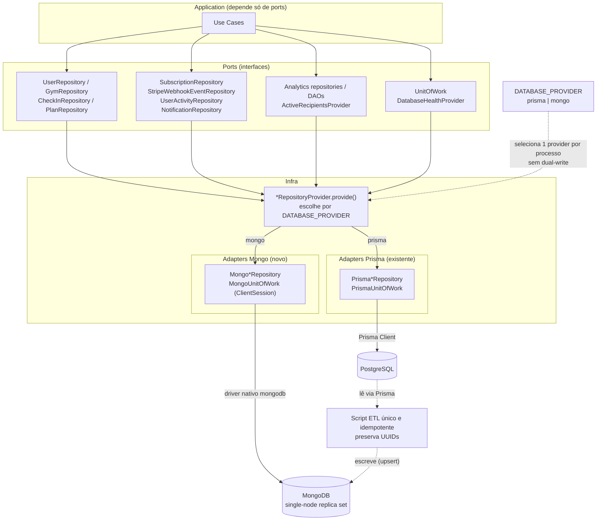

# Coexistência PostgreSQL e MongoDB: Design

## Visão Geral

O backend (`apps/backend`) persiste hoje em PostgreSQL via Prisma 7.8. Este trabalho adiciona o MongoDB como segundo banco, selecionável por `DATABASE_PROVIDER=prisma|mongo`, sem remover o Prisma.

**Entendimento (confirmado pelo usuário):**
- Objetivo: estudo de arquitetura. Provar que a troca de banco fica restrita a `infra`, sem alterar `domain` nem `application`.
- Sucesso: as suítes atuais passam sem mudanças fora de `infra`, o provider `mongo` sobe a API inteira e o Mongo recebe uma cópia do estado atual do Postgres.
- Premissa assumida: ambiente local, sem produção nem janela de downtime.

## Escopo

**Dentro:**
- Adapters Mongo para todos os ports de persistência: 9 repositórios, 2 DAOs, `UnitOfWork`, health e `ActiveRecipientsProvider`.
- Seleção por `DATABASE_PROVIDER` nos `*RepositoryProvider`.
- Script ETL único e idempotente Postgres para Mongo.
- Mongo single-node com replica set no `compose.yaml`, variáveis de ambiente e seed equivalente.
- Contract tests compartilhados e testes de integração contra Mongo real.

**Fora de escopo:**
- Remover Prisma ou Postgres: a coexistência é a decisão D1.
- Dual-write ou sincronização contínua entre bancos: um provider ativo por processo.
- Adapters `sqlite` e `pg` legados: ficam intocados.
- Redis e RabbitMQ: não mudam (`notification-broadcast-fanout` os mantém).
- Mudar ids para ObjectId: o contrato OpenAPI (`format: uuid`) permanece.
- Retenção, purge ou anonimização: seguem as regras de `user-soft-delete`.

**Lentes fechadas:** atributos de qualidade (estudo local: o critério é manutenibilidade e isolamento da persistência, medido por AC-10 e AC-11, sem metas de carga ou disponibilidade); segurança e privacidade (sem dado novo nem exposição nova), rollout para consumidores vivos (nenhum consumidor externo do banco), qualidade operacional em produção (estudo local).

## Arquitetura e Fluxo

Application depende apenas de ports. Cada `*RepositoryProvider.provide` lê `DATABASE_PROVIDER` e devolve o adapter Prisma ou o Mongo; fora de produção, o comportamento atual com in-memory é preservado. O adapter Mongo usa o driver nativo `mongodb`, uma coleção por tabela, com `_id` igual ao UUID string atual. O `MongoUnitOfWork` abre uma `ClientSession` e repassa a sessão aos repositórios pelo mesmo mecanismo `withTransaction(tx)` que o Prisma usa hoje. O ETL lê o Postgres via Prisma e grava no Mongo por `upsert` em lotes, sem participar do runtime da API.

Diagrama fonte: `diagrams/mongodb-coexistence-design_01_flowchart_persistence_coexiste.mmd`

## Componentes

**MongoConnection**
- Responsabilidade: criar e fechar o `MongoClient`, expor `Db` e criar os índices na inicialização.
- Oculta: URL, pool, opções de replica set e a lista de índices por coleção.
- Depende de: `DATABASE_URL_MONGO` (env validado por zod).

**Mongo*Repository / Mongo*Dao (11 classes)**
- Responsabilidade: implementar cada port com o mesmo contrato dos adapters Prisma.
- Oculta: mapeamento documento para entidade (`restore()`), filtros `deleted_at: null` e `includeInactive`, paginação, tradução do erro 11000.
- Depende de: `MongoConnection`, ports do domínio.

**MongoUnitOfWork**
- Responsabilidade: `runTransaction` com `ClientSession.withTransaction`, repetindo em erro transitório.
- Oculta: sessão, retentativa e o símbolo que marca o `tx` para os repositórios.
- Depende de: `MongoConnection`.

**MongoGymNearbyQuery e Mongo analytics (dentro de MongoGymRepository e MongoAnalytics*Repository)**
- Responsabilidade: busca por proximidade (`$geoNear` em 10 km) e agregações por período.
- Oculta: GeoJSON `location` derivado de latitude e longitude, e pipelines de aggregation.
- Depende de: índice `2dsphere`.

**DatabaseProviderSelector (ajuste nos `*RepositoryProvider`)**
- Responsabilidade: escolher o adapter por `DATABASE_PROVIDER`.
- Oculta: a regra de seleção por ambiente.
- Depende de: env, adapters.

**MongoEtlScript (`apps/backend/scripts/etl-postgres-to-mongo.ts`)**
- Responsabilidade: copiar o estado do Postgres para o Mongo e validar.
- Oculta: ordem das coleções, tamanho do lote e conversões de tipo.
- Depende de: Prisma Client, `MongoConnection`.

## Fronteiras e Contratos

| Fronteira (upstream para downstream) | O que atravessa | Distância | Volatilidade | Veredito |
|---|---|---|---|---|
| Application para ports | contratos dos repositórios, DAOs e `UnitOfWork` | mesmo processo | baixa | equilibrado; é o que a tese prova |
| Provider para adapter | instância do repositório | mesmo processo | média | equilibrado |
| Adapter Mongo para MongoDB | driver `mongodb` | outro processo | baixa | equilibrado pelo adapter |
| ETL entre bancos | documentos, em lotes | fora do runtime | baixa | isolado em script |

**Significados:**
- Identificador: UUID string gerado pela aplicação (`Id`); no Mongo é o `_id`.
- Data e hora: instante UTC (`Date`); `created_at` e `deleted_at` mantêm o significado atual.
- Latitude e longitude: número em graus no domínio; o Mongo guarda também `location` GeoJSON `[longitude, latitude]`, derivado e fora do contrato da API.
- Decimal de coordenadas: convertido para `number` no mapeamento, como o repositório Prisma já faz.
- Contagens de analytics: `number`, como hoje após conversão de `bigint`.
- Dia do check-in: `dayKey` string `YYYY-MM-DD` em UTC, derivada de `created_at`.
- Violação de unicidade: o repositório devolve o mesmo erro de domínio que o Prisma devolve em `P2002`.

## Dados e Consistência

| ID | Enunciado | Categoria | Garantidor | Rede |
|---|---|---|---|---|
| INV-01 | Um usuário tem no máximo um check-in por dia | unique | db | - |
| INV-02 | E-mail, CNPJ e `billing_subscription_id` são únicos | unique | db | - |
| INV-03 | Um usuário tem no máximo uma assinatura ativa | unique | db | INV-04 |
| INV-04 | Encerrar a assinatura expirada e criar a nova ocorre numa transação | transition | app+lock | - |
| INV-05 | Excluir `Notification` remove suas `UserNotification` (antigo Cascade) | preserve | app | - |
| INV-06 | Não se exclui `User` ou `Plan` com `Subscription` ou `Notification` associadas (antigo Restrict) | preserve | app | - |
| INV-07 | `StripeWebhookEvent.event_id` único: o mesmo evento processa uma vez | idempotent | db | - |
| INV-08 | Copiar um registro do Postgres para o Mongo preserva todos os campos e o id | roundtrip | app | - |

**Fonte da verdade:** o banco do provider ativo. O ETL é cópia pontual; depois dela, os dois bancos divergem e isso é aceito.

**Mecanismo:** lotes de 500 por coleção, ordenados por `id`, `bulkWrite` com `upsert` por `_id`; ordem respeita as dependências (`Plan`, `User`, `Gym`, `Subscription`, `CheckIn`, `Notification`, `UserNotification`, `UserActivityEvent`, `StripeWebhookEvent`). Uma operação em lote por vez, sem transação global.

**Volume e orçamento:** medido no `postgresql-dev` local: 376 usuários, 50 academias, 189 check-ins, 8 assinaturas, 663 notificações, 663 `user_notifications`, 342 eventos de atividade; menos de 1 minuto, janela livre.

**Critério de fim:** para cada coleção, `count(*)` da tabela = `countDocuments` da coleção, e a amostra de 20 registros por coleção é igual campo a campo.

**Legado que viola:** linha com data de check-in repetida no mesmo dia (INV-01 cobre a regra; o schema Prisma não a declara como constraint) vai para o relatório `etl-report.json` e é excluída da coleção.

**Concorrência:** a unicidade é garantida por índice único no Mongo (INV-01, 02, 03, 07); INV-04 usa transação com sessão.

## Falhas e Erros

| Falha | Detecção | Comportamento | O que o usuário vê | AC |
|---|---|---|---|---|
| Mongo fora do ar na inicialização | ping em `MongoConnection` | a API não sobe, falha com mensagem clara | processo encerra com erro | AC-05 |
| Mongo sem replica set | erro ao abrir transação | falha explícita na inicialização com a dica do `--replSet` | processo encerra com erro | AC-05 |
| Unicidade violada (código 11000) | erro do driver | o repositório lança o mesmo erro de domínio que o Prisma | a mesma resposta HTTP de hoje | AC-02 |
| Conflito transitório de transação | erro `TransientTransactionError` | `withTransaction` repete | nada visível | AC-03 |
| Falha no meio do ETL | exceção no lote | encerra; reexecutar é seguro por `upsert` | relatório indica o lote | AC-06 |
| `DATABASE_PROVIDER` inválido | schema zod do env | a API não sobe | erro de configuração | AC-04 |

## Decisões Arquiteturais

### D1. Vamos manter o Prisma/Postgres e adicionar o Mongo como adapter selecionável por `DATABASE_PROVIDER`

- **Contexto:** alternativas: substituir o Postgres por completo (rejeitada: remove a comparação direta e o rollback); Mongoose como ODM (rejeitada: tipagem fraca e risco de modelar o documento como entidade).
- **Decisão:** vamos coexistir, com um provider ativo por processo.
- **Justificativa:** técnica, prova que a seleção fica em `infra`; de negócio, o estudo precisa comparar e poder voltar.
- **Consequências:** ganha rollback trivial e contract tests nos dois adapters; aceita o dobro de infra e de manutenção de adapters.
- **Conformidade:** regra do dependency-cruiser impede `domain` e `application` de importar `mongodb`; os mesmos contract tests passam nos dois providers.

### D2. Vamos usar o driver nativo `mongodb`, não Prisma

- **Contexto:** o Prisma 7.8.0 instalado não tem conector MongoDB (suporte nativo só até o Prisma 6; o "Prisma ORM 8" não foi verificado). Alternativas: Prisma 6 isolado (rejeitada: conflita com o Prisma 7), Mongoose (rejeitada em D1).
- **Decisão:** vamos usar o driver, com `ClientSession` e `$geoNear`.
- **Justificativa:** técnica, controle total de transações, geo e aggregation; de negócio, sem dependência de uma versão de ORM sem Mongo.
- **Consequências:** ganha independência; aceita mapeamento manual e nenhum tipo gerado.
- **Conformidade:** nenhum import de `mongodb` fora de `infra`.

### D3. Vamos manter UUID string como `_id` e uma coleção por tabela

- **Contexto:** alternativa: ObjectId (rejeitada: muda o contrato OpenAPI e os tipos gerados); modelo orientado a documentos (rejeitada: aumenta o escopo e quebra a comparação).
- **Decisão:** coleções espelham as tabelas; `Plan.features` e `operating_hours` já são arrays e objetos.
- **Justificativa:** técnica, domínio e contrato intactos; de negócio, comparação limpa para o estudo.
- **Consequências:** ganha mudança mínima; aceita referências por id sem FK e `Restrict`/`Cascade` na aplicação (INV-05, INV-06).
- **Conformidade:** contract tests de integridade (AC-07).

**Decisões locais (reversíveis):**

| Decisão | Padrão escolhido | Gatilho para rever |
|---|---|---|
| Busca por proximidade | `2dsphere` com `$geoNear` | resultado diferente do `ST_DistanceSphere` nos testes |
| Analytics | aggregation pipeline | pipeline lento no volume local |
| Check-in único por dia | campo `dayKey` + índice único | fuso diferente do esperado |
| Lote do ETL | 500 documentos | memória ou timeout |
| Variável do Mongo | `DATABASE_URL_MONGO` separada de `DATABASE_URL` | conflito de uso no código |

## Rollout e Compatibilidade

Aditivo: o provider padrão continua `prisma`; sem mudar o env nada muda. Ordem: (1) adapters e índices, (2) compose com replica set, (3) ETL, (4) testes de integração e contract, (5) seed Mongo. Rollback: voltar `DATABASE_PROVIDER=prisma`. O OpenAPI e o frontend não mudam.

## Riscos

| Risco | Onde | Impacto (1-3) | Probabilidade (1-3) | Score | Mitigação |
|---|---|---|---|---|---|
| Tecnologia nova para o time: transações e geo no Mongo | `MongoUnitOfWork`, gym | 3 | 3 | 9 🔴 | Contract tests de transação e proximidade (AC-03, AC-08) |
| Resultado de analytics diferente do SQL | analytics | 2 | 2 | 4 🟡 | Teste comparando as saídas dos dois adapters (AC-09) |
| Replica set mal configurado no compose | infra | 3 | 2 | 6 🔴 | Falha explícita na inicialização (AC-05) |
| Dados legados que violam unicidade | ETL | 2 | 2 | 4 🟡 | Relatório e exclusão no ETL (AC-06) |
| Integridade referencial só na aplicação | exclusões | 3 | 2 | 6 🔴 | Contract tests de INV-05 e INV-06 (AC-07) |

## Testes

**Runner:** `pnpm --filter backend test:run` (unit), `pnpm --filter backend test:e2e:prisma` e novo script para integração Mongo; `pnpm tsc:check`, `pnpm biome:fix` e `pnpm build` devem passar.
**Banco de teste:** serviço Mongo com replica set do `compose.yaml` (`DATABASE_URL_MONGO` em `.env.test`); Postgres existente para o Prisma.

- AC-01 · WHEN `DATABASE_PROVIDER=mongo` THEN a API sobe e as rotas de usuário, academia, check-in e assinatura funcionam (origem: D1)
- AC-02 · WHEN um e-mail, CNPJ ou check-in do dia repete THEN a resposta é a mesma do provider `prisma` (origem: Falhas: Unicidade violada)
- AC-03 · WHEN o check-in grava dentro do `UnitOfWork` e uma etapa falha THEN nada fica gravado (origem: Falhas: Conflito transitório de transação)
- AC-04 · WHEN `DATABASE_PROVIDER` é inválido THEN a API não sobe (origem: Falhas: DATABASE_PROVIDER inválido)
- AC-05 · WHEN o Mongo está fora ou sem replica set THEN a API falha na inicialização com mensagem clara (origem: Falhas: Mongo fora do ar)
- AC-06 · WHEN o ETL roda duas vezes THEN o resultado é idêntico e as contagens batem (origem: Falhas: Falha no meio do ETL)
- AC-07 · WHEN se exclui uma `Notification` THEN suas `UserNotification` somem; WHEN se exclui um `User` com assinatura THEN a exclusão é recusada (origem: D3)
- AC-08 · WHEN se busca academias a 10 km THEN o resultado é o mesmo do adapter Prisma (origem: D2)
- AC-09 · WHEN as analytics rodam nos dois providers sobre os mesmos dados THEN os resultados são iguais (origem: fato do usuário (Escopo))
- AC-10 · WHEN os contract tests rodam THEN passam em in-memory, Prisma e Mongo (origem: D1)
- AC-11 · WHEN `domain` ou `application` importam `mongodb` THEN o fitness test falha (origem: D1)
